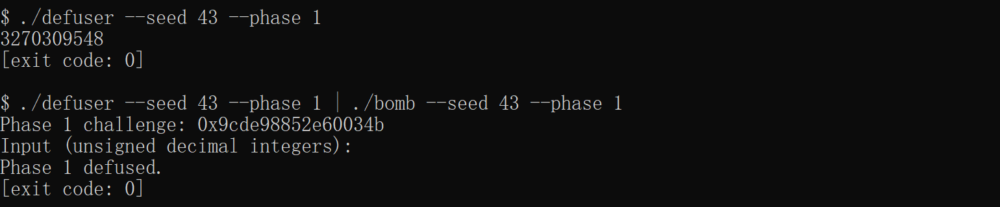
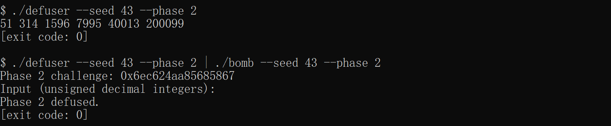
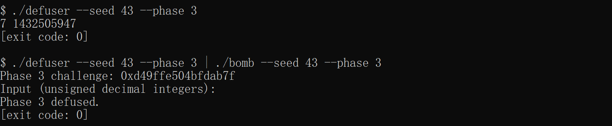
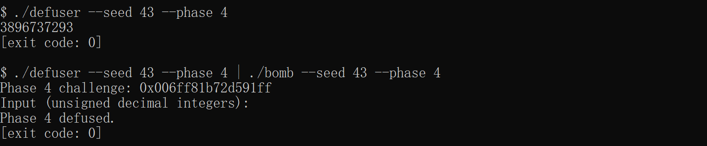
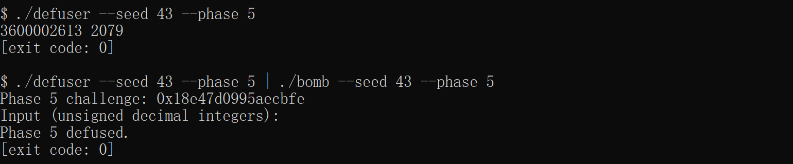
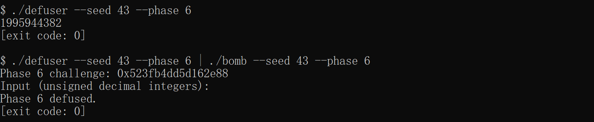
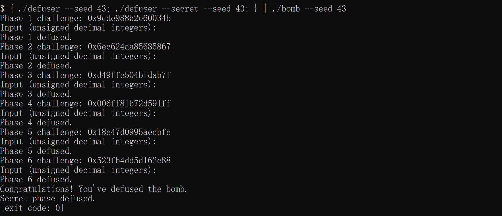
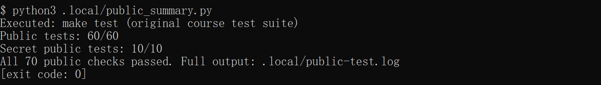
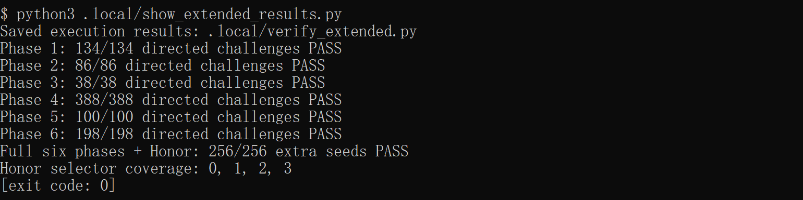

# Lab2：BombLab 实验报告

## 1. 实验环境与分析方法

这次实验在 Ubuntu 22.04（WSL 2）中完成，系统架构是 Linux x86_64，使用 Python 3.10.12 和 GDB 12.1。编译直接使用模板中的 Makefile，C11 标准及 `-O2 -Wall -Wextra -Wpedantic -Werror` 等选项没有修改。

分析时先用 `objdump` 查看各关的汇编，从输入解析处确认口令有几个整数、分别存在哪里，再顺着 challenge 的计算过程往下看。遇到辅助函数就继续查看它的汇编，最后把计算结果和输入的比较对应起来。数组、指针和中间值则用 GDB 核对。求解代码都写在 `defuser.c` 中，炸弹、驱动和测试程序没有修改。

报告中为方便表示，我把 challenge 记作 `c`。`(uint32_t)` 表示转换为 32 位无符号整数，只保留低 32 位；`^`、`&`、`>>` 分别表示按位异或、按位与和逻辑右移。代码中，原始 challenge 用 `uint64_t` 保存，大部分计算结果用 `uint32_t` 保存，对应汇编里的 32 位运算。这样加法和乘法溢出时会按 2³² 回绕，不会把本来应该丢弃的高位带入后续计算。

除了公开测试，六关和 Honor 都用 **seed 43** 另外验证了一次。43 不在 `tests/public.json` 的公开列表中，符合报告对额外验证的要求。以第 1 关为例，先查看求解程序给出的口令，再把口令交给炸弹检查：

```bash
./defuser --seed 43 --phase 1
./defuser --seed 43 --phase 1 | ./bomb --seed 43 --phase 1
```

其余关卡也用相同方式验证，`--phase` 分别取 2～6，具体结果见各节截图。报告中的口令是这次验证得到的结果，程序本身仍根据传入的 challenge 计算答案。

## 2. Phase 1：函数调用与参数传递

第 1 关读入一个无符号整数。`sscanf` 解析输入后调用 `p1_compute`，接着比较返回值和输入：

```asm
mov  %r12,%rdi
call p1_compute
cmp  %eax,-0x14(%rbp)
sete %al
```

这里 `r12` 保存的是 challenge，`eax` 是 `p1_compute` 的返回值，所以输入的整数必须等于这个函数的计算结果。这一关的计算过程主要集中在 `p1_compute` 中。

函数先从 challenge 中取出三个量：

```text
L = (uint32_t)c
H = (uint32_t)(c >> 32)
M = (uint32_t)(c >> 16)
```

之后依次调用 `p1_step0`、`p1_step1` 和 `p1_step2`。第一个函数中主要是这两条指令：

```asm
xor $0x9eee,%esi
lea (%rsi,%rdi,2),%eax
```

`lea` 在这里计算的是加法和乘法，并没有读取内存。虽然参与运算的 `rdi` 保存完整的 challenge，但结果写入 `eax` 后只剩低 32 位，因此可以改用 `L` 计算。把后两个函数也展开后，得到：

```text
A = (uint32_t)((H ^ 0x9eee) + 2U * L)
B = (uint32_t)(M + 0x94fb) ^ H
C = (uint32_t)(3U * B + L) ^ 0xed48
answer = C ^ A
```

最后的 `xor %ecx,%eax` 又用到了第一个函数的结果 `A`。查看后两个函数的汇编后，可以确认它们都没有改写 `ecx`，所以这里保留的仍然是 `A`，最终答案就是 `C ^ A`。

用 seed 43 运行时，challenge 是 `0x9cde98852e60034b`，求出的口令为 `3270309548`，结果显示 `Phase 1 defused.`。



## 3. Phase 2：数组、循环与递推

第 2 关需要六个整数。程序先单独检查第一个数，再通过循环检查后五个数。计算首项的指令是：

```asm
shr $0x20,%rax
add %eax,%eax
and $0x1e,%eax
add $0x1f,%eax
```

这几条指令先取 challenge 的高 32 位，再乘 2、与 30 按位与，最后加 31，得到 `a[0] = ((2U * H) & 30U) + 31U`。后面的循环用 `rdx` 作下标，从 1 到 5；`ecx` 控制右移位数，初值是 7，每轮加 3。

```asm
lea  0xa(%rdx),%edi
lea  (%rsi,%rsi,4),%esi
shr  %cl,%rax
and  $0x3f,%eax
xor  %edi,%eax
add  %esi,%eax
```

其中，`lea (%rsi,%rsi,4),%esi` 把前一项乘以 5，剩下的加数来自 challenge 的一段比特和 `i + 10` 的异或。把第 `i` 轮的移位量写成 `3 * i + 4` 后，递推关系如下：

```text
a[0] = ((2U * H) & 30U) + 31U
a[i] = (uint32_t)(5U * a[i - 1] + (((c >> (3 * i + 4)) & 63U) ^ (i + 10U)))
       i = 1, 2, 3, 4, 5
```

实现时按这个递推式计算六项，再依次输出。循环从 `i = 1` 开始，到 `i = 5` 结束，与汇编中的下标范围一致。

seed 43 对应的 challenge 是 `0x6ec624aa85685867`，六个数为：

```text
51 314 1596 7995 40013 200099
```



## 4. Phase 3：switch 与跳转表

第 3 关读入两个整数。第一个数先与 `c & 7` 比较，通过后才调用 `p3_dispatch` 计算第二个数。传入的分支编号和运算参数分别是：

```text
k = c & 7
x = (uint32_t)(c >> 3) ^ (uint32_t)(c >> 32)
```

`p3_dispatch` 先检查编号是否超过 7，再从跳转表中取地址：

```asm
cmp $0x7,%eax
ja  ...
notrack jmp *0x405820(,%rax,8)
```

表项间隔为 8 字节。用 `x/8gx 0x405820` 读出八个地址，再查看这些地址处的 `jmp`，才得到实际调用的函数。这里表项顺序和函数编号并不一致，例如编号 0 最后跳到的是 `p3_case_5`。

| k | 实际进入的函数 | 第二个整数 |
|---:|---|---|
| 0 | `p3_case_5` | `(uint32_t)(4U * x) ^ 0x268e` |
| 1 | `p3_case_6` | `(uint32_t)(5U * x + 0x23bc2)` |
| 2 | `p3_case_3` | `(uint32_t)(2U * x) ^ 0xa07f` |
| 3 | `p3_case_1` | `(uint32_t)(5U * x + 0x2ec5c)` |
| 4 | `p3_case_0` | `(uint32_t)((x ^ 0x289d) + (x >> 2))` |
| 5 | `p3_case_4` | `(uint32_t)((x ^ 0xf7a8) + (x >> 1))` |
| 6 | `p3_case_7` | `(uint32_t)(5U * x + 0x53d9)` |
| 7 | `p3_case_2` | `(uint32_t)(5U * x + 0xd620)` |

根据这张表，代码用 `switch` 计算第二个整数，第一个整数直接填写分支编号。额外测试中八个编号都进行了验证。

seed 43 的 challenge 是 `0xd49ffe504bfdab7f`，低三位为 7，因此走 `p3_case_2`，输出 `7 1432505947`，通过验证。



## 5. Phase 4：递归调用与返回

第 4 关输入一个整数，需要与 `p4_walk` 的返回值相等。调用前，程序从 challenge 中算出目标值和辅助参数 `salt`：

```text
target = c & 127
salt = (uint32_t)(c >> 7) ^ (uint32_t)(c >> 32)
初始区间为 [0, 127]
```

`p4_walk` 每次先计算当前区间的中点，再与 target 比较：

```asm
sub %esi,%edi
shr %edi
add %esi,%edi
cmp %eax,%edi
je  ...
```

把中点记为 `m = low + ((high - low) >> 1)`。target 等于 `m` 时，函数直接返回 `(m + 100) ^ salt`；否则进入左半区间或右半区间，返回时再计算：

```text
target < m：
    child = walk(target, low, m - 1, salt)
    return (uint32_t)(3U * child) ^ (uint32_t)(m + salt) ^ 8U

target > m：
    child = walk(target, m + 1, high, salt)
    return (uint32_t)(3U * child) ^ (uint32_t)(m + salt) ^ 10U
```

左右两条路径返回后都有 `lea (%rax,%rax,2),%eax`，也就是把子调用结果乘以 3，再与本层的 `m + salt` 异或。两条路径最后分别异或 8 和 10。答案还包含这些返回时的运算，不能只计算递归终点。代码因此保留了同样的递归结构。

target 的范围是 0～127，每次递归都会缩小包含 target 的区间，最终能够找到目标。验证时也检查了全部 128 个 target，包括边界上的 0 和 127。

seed 43 对应 `0x006ff81b72d591ff`，target 为 127，计算得到 `3896737293`，通过检查。



## 6. Phase 5：结构体布局与链表遍历

第 5 关的计算在 `p5_traverse` 中完成，需要输出累计结果和最后访问节点的编号。从下面几条访存指令可以看出节点的字段位置：

```asm
mov (%rdx),%rdx       # next，八字节指针
mov 0x8(%rdx),%esi    # 节点编号，四字节
add 0xc(%rdx),%eax    # 节点数值，四字节
```

结合内存中的节点间隔，可以确定一个节点占 16 字节：偏移 0 是 `next` 指针，偏移 8 是编号，偏移 12 是数值。下面把从 `p5_nodes`（`0x405ba0`）开始的十二个节点记为 0～11，整理出的数据如下：

| 节点 | next 节点 | 编号（十六进制） | 数值（十六进制） |
|---:|---:|---|---|
| 0 | 9 | `081f` | `d329` |
| 1 | 4 | `0364` | `741b` |
| 2 | 3 | `025f` | `8c1d` |
| 3 | 7 | `0926` | `e495` |
| 4 | 8 | `0751` | `e5fd` |
| 5 | NULL | `044c` | `3468` |
| 6 | 11 | `0634` | `ae19` |
| 7 | 1 | `0a0d` | `a615` |
| 8 | 6 | `0136` | `9b98` |
| 9 | 5 | `0028` | `75d6` |
| 10 | 2 | `052d` | `192d` |
| 11 | 0 | `0b1b` | `7a93` |

头指针表中的八项分别指向 `[10, 2, 3, 7, 1, 4, 8, 6]`。按 next 指针连接起来后，链表顺序是：

```text
10 → 2 → 3 → 7 → 1 → 4 → 8 → 6 → 11 → 0 → 9 → 5 → NULL
```

入口、访问节点数和初始累计值都由 challenge 决定：

```text
入口编号 = c & 7
访问数量 = ((c >> 3) & 3) + 1
acc = (uint32_t)(c >> 6) ^ (uint32_t)(c >> 32) ^ 0xb9ee
```

每访问一个节点，就计算 `acc = (uint32_t)(3U * acc + value) ^ identifier`，同时记录当前编号。原程序在循环前已经处理了入口节点，所以即使额外跳转次数为 0，也会访问一个节点。总访问数因此是 1～4，而不是 0～3。

解法里用节点下标代替原来的指针，连接顺序不变。这样不用依赖炸弹中的地址，也能复现相同的遍历过程。两个输出分别填写最后的 `acc` 和节点编号。

用 seed 43 验证时，challenge 为 `0x18e47d0995aecbfe`，输出 `3600002613 2079`，结果通过。



## 7. Phase 6：函数指针表与间接调用

第 6 关输入一个整数，主要计算在 `p6_dispatch` 中。它从函数指针表中取出地址，连续调用两次：

```asm
call *0x405e00(,%rax,8)
xor  $0x1464,%eax
mov  %eax,%edi
call *0x405e00(%rbx)
add  $0x519e,%eax
```

第一次的下标是 `c & 7`。第二次调用使用 `rbx = c & 0x38`，这个值已经是字节偏移，对应的表下标为 `(c >> 3) & 7`。两次调用前的数据可以整理为：

```text
first = c & 7
second = (c >> 3) & 7
x = (uint32_t)(c >> 6) ^ (uint32_t)(c >> 32)
```

读取 `p6_ops` 后，八个表项对应 `[3, 2, 0, 3, 1, 4, 5, 5]`，其中数字表示 `p6_op_N` 的 N。表中有重复的函数地址，例如下标 0 和 3 都指向 `p6_op_3`。各个函数的计算如下：

| 操作函数 | 对输入 x 的运算 |
|---|---|
| `p6_op_0` | `(uint32_t)(x + 0x8056) ^ (x >> 5)` |
| `p6_op_1` | `(uint32_t)((x ^ 0x4239) + (x << 5))` |
| `p6_op_2` | `rol32(x, 1) ^ 0x4954` |
| `p6_op_3` | `(uint32_t)(2U * x + 0x6d1d) ^ (uint32_t)(3U * x)` |
| `p6_op_4` | `(uint32_t)((x ^ (x >> 7)) + 0x62c0)` |
| `p6_op_5` | `ror32(x, 7)` |

表中的 `rol32` 和 `ror32` 是 32 位循环移位，移出的位会接回另一端。下面用 `op[i]` 表示指针表第 i 项对应的函数；第一次调用的结果先异或 `0x1464`，再传给第二次调用，最后加上 `0x519e`：

```text
y = op[first](x) ^ 0x1464
answer = (uint32_t)(op[second](y) + 0x519e)
```

实现按照这个顺序串联两次操作。额外测试检查了 8 × 8 种函数选择组合，并换用不同的高位数据验证循环移位和溢出处理。

seed 43 的 challenge 为 `0x523fb4dd5d162e88`，得到 `1995944382`，通过验证。



## 8. Honor：相邻字段覆盖与 context 校验

Honor 需要先通过六关，再从文件或管道中读入第七行。除了 challenge，`solve_secret` 还接收一个 context，它由驱动根据前六行口令计算，所以这里只使用传入的 context。

### 8.1 第七行的布局

Honor 的入口是 `secret_gate`。它把第七行复制到 `rbp - 0xd0` 开始的位置，然后检查 `rbp - 0xb0` 处的标记，再把 `rbp - 0xac` 作为答案字符串传给 `secret_phase`：

```asm
lea   -0xd0(%rbp),%r12
call  secret_copy
cmpl  $0x4e45504f,-0xb0(%rbp)
lea   -0xac(%rbp),%rdi
call  secret_phase
```

以复制的起点为基准，标记位于偏移 32，答案从偏移 36 开始。检查值 `0x4e45504f` 按小端序存放时，四个字节是 `4f 50 45 4e`，正好对应 `OPEN`。因此第七行写成：

```text
32 个 A + OPEN + 三个空格分隔的无符号十进制整数
```

`secret_copy` 会一直复制到字符串末尾的零字节，因此前 32 个 A 填入字符区，后面的 `OPEN` 和三个整数就落在相邻的标记及答案字段中。这个过程没有涉及返回地址，仍然由程序正常调用 `secret_phase`。

长度检查要求第七行在 36～163 字节之间。这里前缀占 36 字节，三个整数连同空格最多占 23 字节，总长不超过 59 字节，符合要求。

### 8.2 三个整数的计算

进入 `secret_phase` 后，第一个整数先与 `context & 3` 比较。计算后两个整数时，需要用到 challenge 和 context 各自高低 32 位的异或，记为：

```text
q = context & 3
f = (uint32_t)challenge ^ (uint32_t)(challenge >> 32)
g = (uint32_t)context ^ (uint32_t)(context >> 32)
x = f ^ g
```

接着调用的 `secret_mix` 主要做以下运算：

```asm
mov %edi,%eax
xor $0xf220,%edi
shr $0x5,%eax
xor $0x345f,%eax
add %edi,%eax
```

把 `secret_mix` 和返回后的运算合起来，三个整数之间的关系就是：

```text
mix = (uint32_t)(((x >> 5) ^ 0x345f) + (x ^ 0xf220))
v = mix ^ (uint32_t)(q * 0xf220) ^ (uint32_t)(context >> 16)
w = v ^ (uint32_t)((f >> 5) + g + q + 0x345f)
```

最后在 `OPEN` 后面按顺序写入 `q v w`。代码用 `snprintf` 拼接这一行，并检查是否发生截断。

seed 43 得到的第七行是：

```text
AAAAAAAAAAAAAAAAAAAAAAAAAAAAAAAAOPEN1 975667423 2375020053
```

验证时把六关口令和第七行一起交给炸弹：

```bash
{ ./defuser --seed 43; ./defuser --secret --seed 43; } | ./bomb --seed 43
```

这次运行六关全部通过，最后也输出了 `Secret phase defused.`。



## 9. 测试结果与边界检查

代码完成后重新编译，运行 `make test`，六关公开测试通过 `60/60`，Honor 通过 `10/10`。为方便截图，本地脚本执行原始测试后只显示两个汇总结果，完整输出另存为日志。



只测公开 seed 不一定能覆盖全部分支，因此又用 `--challenge` 指定输入，检查各关的边界情况。每个输入都先由解法生成口令，再交给个人炸弹验证，结果如下：

| 关卡 | 额外定向 challenge 数 | 主要覆盖内容 | 结果 |
|---|---:|---|---|
| Phase 1 | 134 | 零、全一、单比特及其反码、32 位边界 | 全通过 |
| Phase 2 | 86 | 各比特位置、首项相关高位、移位边界 | 全通过 |
| Phase 3 | 38 | 八个分支和多种输入高位模式 | 全通过 |
| Phase 4 | 388 | 全部 128 个目标和三种高位模式，另加边界值 | 全通过 |
| Phase 5 | 100 | 八个入口、四种访问数量、三种高位模式，另加边界值 | 全通过 |
| Phase 6 | 198 | 64 种两次调用组合、三种数据模式，另加边界值 | 全通过 |
| 合计 | 944 |  | 全通过 |

另外，用固定随机种子 `20261030` 生成额外 seed，去掉公开列表中的值和重复值，再计入前面使用的 43，共检查了 256 组“六关 + Honor”的完整流程，全部通过。Honor 的 `q = 0、1、2、3` 四种情况也都测到了。

下图是额外测试保存的结果汇总，辅助脚本和完整记录放在本地 `.local/` 中。



输出缓冲区也单独做了检查：七个求解接口分别使用 0～256 字节的容量，共 14392 次，均通过。容量不足时返回非零，容量足够时输出完整，边界外的保护字节也没有被改写。同时开启 AddressSanitizer 和 UndefinedBehaviorSanitizer，未发现异常。

以上为本地验证结果，最终成绩以助教评分为准。

## 10. 小结

这次实验中，几处看起来很短的指令实际影响很大。第 1 关最后还要异或之前保留的结果，第 3 关的表项顺序与函数编号不同，第 5 关在循环前已经访问了头节点。把这些位置和变量含义对应清楚后，才能准确写出计算过程。

验证时也按各关的结构补了测试：switch 检查所有编号，递归检查全部目标，链表检查入口和访问数量，函数指针表检查两次选择的组合。Honor 则和前六行一起运行，因为它的 context 依赖前面的口令。这样比只换几个 seed 更容易检查到遗漏的情况。

## 参考资料与辅助工具

1. [课程 BombLab 实验文档](https://ics-26fall-fdu.github.io/labs/lab2-bomb-lab/)：接口、运行方式、报告及提交要求。
2. [课程模板仓库](https://github.com/ICS-26Fall-FDU/BombLab)：README、tutor、teaching 和公开测试。
3. [GDB 官方文档](https://www.sourceware.org/gdb/documentation/)：反汇编、断点、单步和内存查看命令。
4. 使用 OpenCode 辅助理解汇编指令、调用约定、C 语言语义和 GDB，并协助解法实现与调试、运行测试、采集截图和整理报告。分析中的数值及运行结果均经过实际验证。
